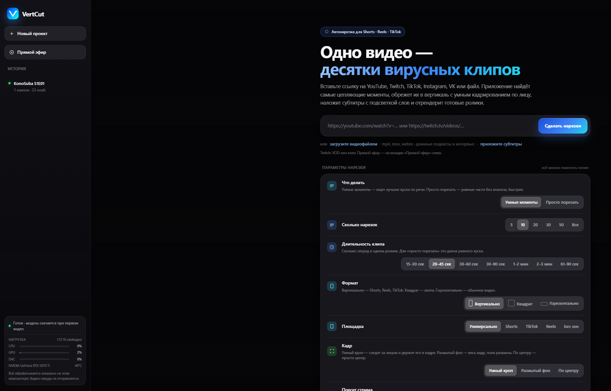
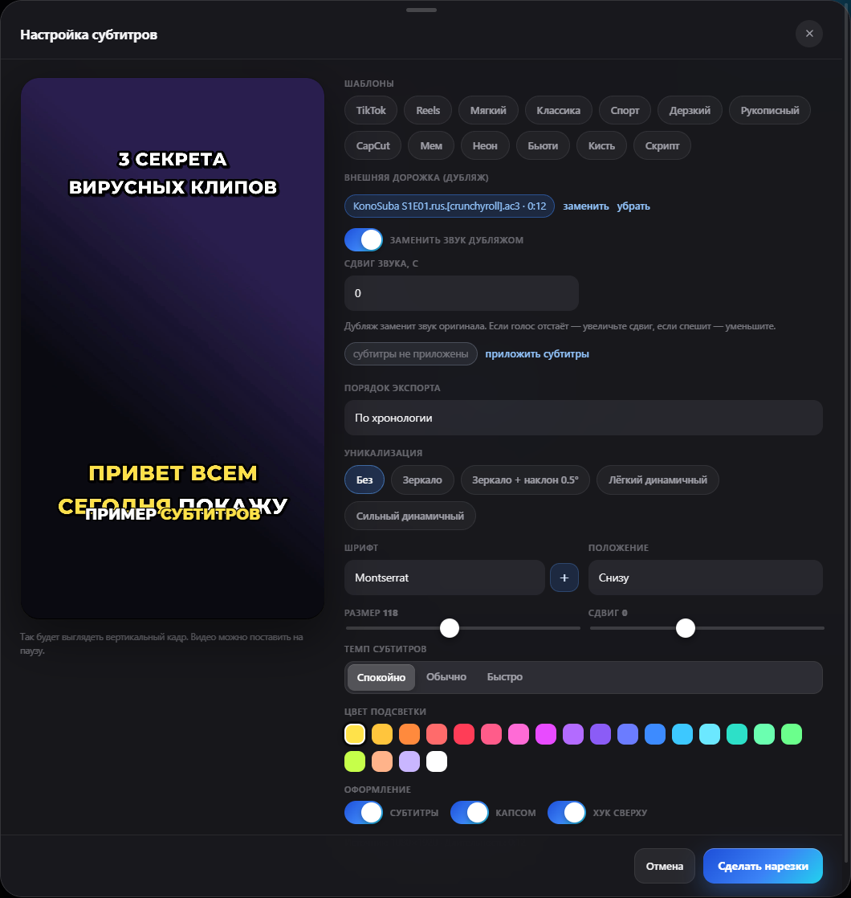
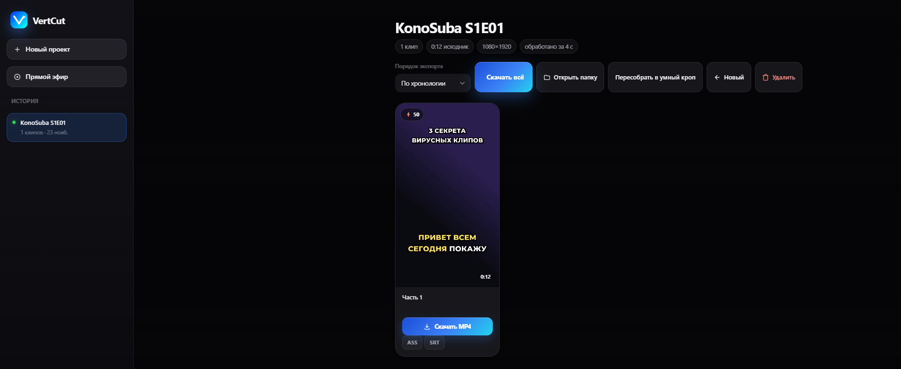

# VertCut

**Длинное видео → вертикальные клипы.** Локально, без облака и подписок:
скачивание, распознавание речи, умное кадрирование по лицу, караоке-субтитры
и рендер 9:16 / 1:1 / 16:9.

[](https://www.python.org/)
[](#быстрый-старт)
[](#приватность)
[](LICENSE)
[](https://github.com/sulinetz/vertcut/stargazers)

[Страница проекта](https://sulinetz.github.io/vertcut/) ·
[Документация](PROJECT_CONTEXT.md) ·
[Windows](docs/WINDOWS.md) ·
[Changelog](CHANGELOG.md)



## Содержание

- [Возможности](#возможности)
- [Быстрый старт](#быстрый-старт)
- [Звук и дубляж](#звук-и-дубляж)
- [Субтитры](#субтитры)
- [Процессор и видеокарта](#процессор-и-видеокарта)
- [Пресеты кадра и уникализация](#пресеты-кадра-и-уникализация)
- [Данные и приватность](#данные-и-приватность)
- [Настройки](#настройки)
- [Структура](#структура)
- [Тесты](#тесты)
- [Лицензия и происхождение](#лицензия-и-происхождение)

## Возможности

| Возможность | Что делает |
|---|---|
| **Моменты сам** | Ищет фрагменты по речи, паузам, громкости, эмоциям и цифрам. Оценка вирусности, отбор без пересечений. |
| **Умный кроп** | Следит за лицом и не режет говорящего. Если лиц нет — размытый фон вместо чёрных полос. |
| **Караоке-субтитры** | Подсветка слов, 24 шрифта, свои TTF/OTF, размер, позиция, темп и цвет. |
| **Внешний дубляж** | Отдельный `.ac3`, `.mka`, `.mkv` и др.: заменяет оригинальный звук, выбор дорожки внутри файла, ручной сдвиг. |
| **Свои субтитры** | `.srt`, `.ass`, `.ssa`, `.vtt` или вшитая текстовая дорожка — раньше Whisper. |
| **Пресеты стрима** | Игра + врезка с лицом, полоса снизу/сверху, сплит-скрин с фоновым роликом. |
| **Уникализация** | Зеркало, наклон, скорость, питч, склейки пауз, зум на стыках — по умолчанию выключено. |
| **Прямой эфир** | Клипы появляются, пока стрим ещё идёт; готовый клип можно перерендерить. |
| **Пакетный экспорт** | Имена `01 — Название.mp4`, порядок «по хронологии» или «топ моменты», ZIP и папка `named/`. |
| **Приватность** | Whisper, ffmpeg и OpenCV работают на вашем компьютере. Нет аккаунтов и API-ключей. |

<p align="center">
  
  
</p>

## Быстрый старт

Нужен **Python 3.11–3.13 x64** и ~2 ГБ на диске под зависимости и модель
Whisper. Готовых архивов пока нет — проект запускается из исходников.

**Windows, один клик:**

```bat
run_windows.bat
```

Скрипт создаст `.venv-win`, поставит зависимости и откроет окно приложения.
Повторный запуск — тот же файл, установка пропускается.

**Вручную (Windows / macOS / Linux):**

```powershell
python -m venv .venv
# Windows: .\.venv\Scripts\python.exe
# macOS/Linux: ./.venv/bin/python
.\.venv\Scripts\python.exe -m pip install -r requirements-desktop.txt
.\.venv\Scripts\python.exe desktop\main.py
```

Только сервер, интерфейс в браузере:

```powershell
.\.venv-win\Scripts\python.exe -m vertcut --port 8765
```

Откройте `http://127.0.0.1:8765`.

## Звук и дубляж

Сценарий «аниме на японском + русская дорожка отдельным файлом» поддерживается
напрямую.

1. Загрузите видео (`.mkv`, `.mp4`, …) — откроется окно **«Настройка субтитров»**.
2. В правой колонке найдите **«Внешняя дорожка (дубляж)»**.
3. Нажмите **«подключить»** и выберите `...rus.[crunchyroll].ac3` (или `.mka`,
   `.mkv`, `.mp3`, `.flac` — список ниже).
4. Галочка **«Заменить звук дубляжом»** включится сама.
5. Если голос разъехался с картинкой, поправьте **«Сдвиг звука, с»**:
   положительное значение задерживает дубляж, отрицательное ускоряет.

Что происходит дальше:

- дубляж **полностью заменяет** оригинальный звук, включая склейки пауз,
  скорость, питч, нормализацию громкости и фоновую музыку;
- если дубляж короче видео или сдвиг выводит за его границы, недостающее
  заполняется тишиной — звук не отстаёт после склеек;
- Whisper распознаёт **русский дубляж** с учётом сдвига, поэтому субтитры
  совпадают с озвучкой;
- приложенный `.srt`/`.ass` важнее распознавания; если в контейнере дубляжа
  есть своя текстовая дорожка, возьмётся она;
- в редакторе клипа есть переключатель дубляжа и сдвиг для перерендера.

Поддерживаемые форматы дубляжа: `.mka`, `.mkv`, `.mp4`, `.m4v`, `.mov`,
`.webm`, `.mp3`, `.m4a`, `.aac`, `.wav`, `.ogg`, `.flac`, `.opus`, `.ac3`,
`.eac3`, `.dts`, `.ts`.

> **Вшитая дорожка внутри видео** — отдельный выбор «Дорожка звука». Он
> появляется, когда в файле две дорожки и больше (например, японская и русская),
> и влияет и на Whisper, и на звук готовых клипов.

## Субтитры

Текст не обязательно распознавать заново. Порядок выбора:

1. приложенный файл `.srt`, `.ass`, `.ssa`, `.vtt`;
2. текстовая дорожка контейнера дубляжа (русская в приоритете);
3. вшитая текстовая дорожка исходного видео;
4. Whisper.

Принудительно включить Whisper: `subtitle_source: "whisper"` в опциях проекта.
Bitmap-дорожки (PGS/DVD) и «хардсабы» в картинке не поддерживаются.

## Процессор и видеокарта

Одна сборка работает на любой машине. При старте приложение проверяет CUDA:

- **NVIDIA + CUDA** → `cuda` / `float16`, быстро;
- **без CUDA** → `cpu` / `int8`, медленнее, но работает везде.

Выбор виден в `/api/health` (`device`) и в `app.log`. Принудительно:
`VERTCUT_DEVICE=cuda|cpu`.

Если NVIDIA есть, а CUDA-библиотек нет:

```powershell
.\.venv-win\Scripts\python.exe tools\enable_cuda.py
```

CUDA Toolkit целиком не нужен. На RTX 5070 Ti час видео распознаётся примерно
за 30 секунд против ~9 минут на процессоре.

Кодирование H.264 идёт через NVENC/QSV/VideoToolbox, если ffmpeg их видит;
при ошибке рендер откатывается на `libx264`. Сравнить свой компьютер:

```powershell
.\.venv-win\Scripts\python.exe tools\bench_render.py --seconds 30
```

## Пресеты кадра и уникализация

| Пресет | Что делает |
|---|---|
| Полоса снизу | игра сверху, лицо полосой 640 px снизу |
| Полоса сверху | лицо полосой 640 px сверху, игра снизу |
| Сплит-скрин | верх — видео, низ — фоновый ролик из `assets/adhd_bg` |

Окно кадрирования не накрывает оригинальную врезку, поэтому второго лица в
кадре не появляется. Субтитры встают выше панели с лицом и интерфейса площадки.

Уникализация: зеркало, наклон 0–3°, скорость 1.00–1.10×, питч 0.95–1.05×,
склейки пауз, зум на склейках, доля и фон сплита. Склейки и скорость
пересчитывают и слова, и траекторию кропа (`vertcut/timeline.py`), поэтому
караоке не разъезжается с картинкой.

## Данные и приватность

`%APPDATA%\VertCut` — база, проекты, модели, логи (`app.log`). На macOS:
`~/Library/Application Support/VertCut`.

Тяжёлые проекты можно вынести на другой диск: `VERTCUT_PROJECTS` или файл
`%APPDATA%\VertCut\projects_dir.txt` с одной строкой пути.

Модель Whisper (`small`, ~500 МБ) скачивается при первой транскрипции.
`ffmpeg` подтягивается из `imageio-ffmpeg`.

<p align="center"></p>

## Настройки

| Переменная | По умолчанию | Что делает |
|---|---|---|
| `VERTCUT_DATA` | `%APPDATA%\VertCut` | папка данных |
| `VERTCUT_PROJECTS` | `<данные>/projects` | папка тяжёлых проектов |
| `VERTCUT_TEMP` | рядом с проектами | временные файлы загрузок и ffmpeg |
| `VERTCUT_MAX_UPLOAD_GB` | `0` (без лимита) | максимальный размер загрузки, ГБ |
| `VERTCUT_WHISPER` | `small` | `tiny`/`base`/`small`/`medium`/`large-v3` |
| `VERTCUT_WHISPER_DIR` | — | локальная папка с моделью |
| `VERTCUT_DEVICE` | `auto` | `auto`/`cpu`/`cuda` |
| `VERTCUT_COMPUTE` | `int8` | вычисления на CPU |
| `VERTCUT_CUDA_COMPUTE` | `float16` | вычисления на GPU |
| `VERTCUT_WORKERS` | `1` | параллельные обработки |
| `VERTCUT_PORT` | `8765` | порт локального API |
| `VERTCUT_FFMPEG` | — | путь к своему `ffmpeg` |

## Структура

```text
vertcut/    FastAPI, скачивание, Whisper, кадрирование, субтитры, рендер
web/        интерфейс: index.html, app.js, styles.css
desktop/    окно pywebview и запуск сервера
assets/     шрифты, иконки, YuNet, плагины yt-dlp
tests/      pytest
tools/      служебные скрипты (CUDA, бенчмарк, проверки)
docs/       страница проекта и документация
```

## Тесты

```powershell
.\.venv-win\Scripts\python.exe -m pytest tests -q
```

Ожидаемый результат: **132 passed, 4 skipped**. Тесты покрывают анализ,
субтитры, платформы, раскладки стрима, опции, fps, таймлайн, команду ffmpeg,
аудиодорожки, внешний дубляж и экспорт.

## Лицензия

VertCut — самостоятельный проект. Условия использования исходников — в
[`LICENSE`](LICENSE), лицензии сторонних компонентов (ffmpeg, Whisper,
yt-dlp, шрифты и др.) — в [`THIRD_PARTY_NOTICES.md`](THIRD_PARTY_NOTICES.md).
